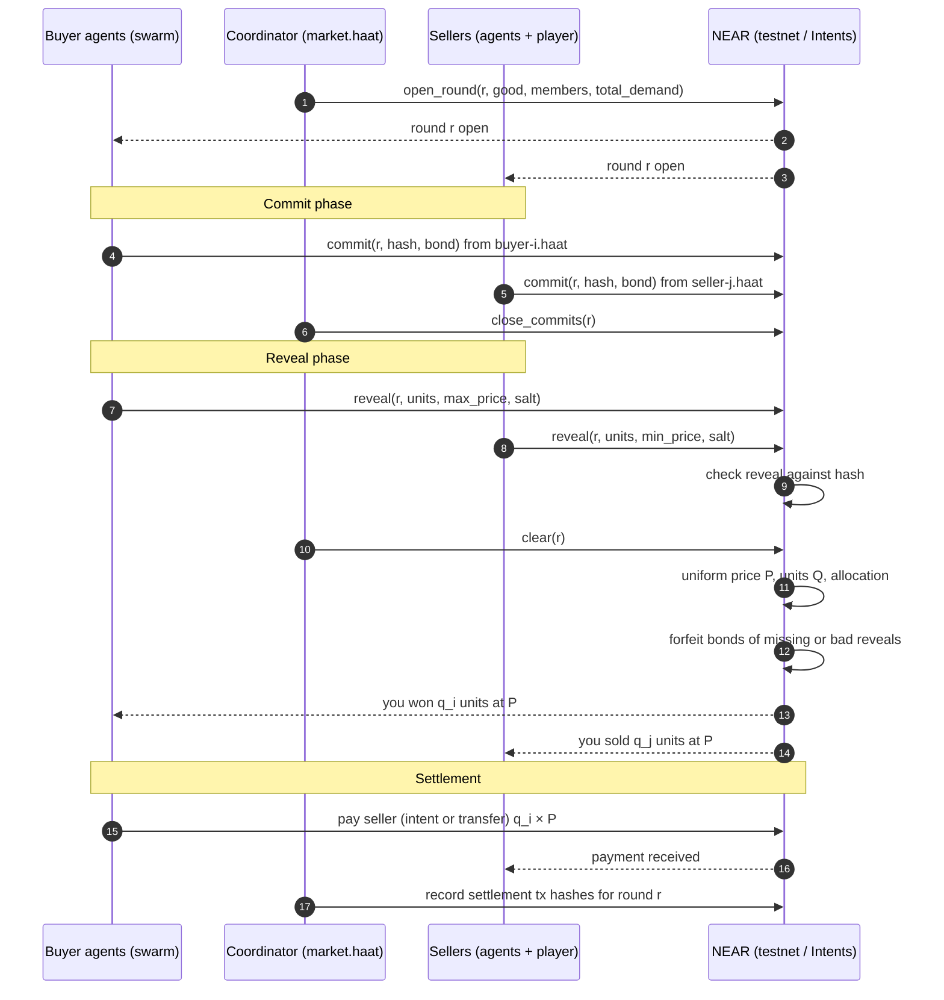

# Haat — Market Rules

Haat is a small market town. Its 25 residents are AI agents, each with its own
NEAR wallet. Every in-game "day" the townsfolk who need the same good band
together into a buying swarm and run a sealed-bid market against the sellers.
You are one of those sellers: you run a stall, decide what to make, and bid
against agent sellers who learn from every round.

These rules are the spec. Code follows them; if they disagree, the code is wrong.

Tracks: Games With Real Economies, AI Swarms, Agent Economy.

---

## 1. Accounts

Every agent acts from its own sub-account, so every on-chain action traces back
to one agent.

| Who | Count | Account |
|---|---|---|
| Parent (owns the town, funds agents) | 1 | `haat.testnet` (name TBD) |
| Coordinator (opens and clears rounds) | 1 | `market.haat.testnet` |
| Buyer agents | 20 | `buyer-1.haat.testnet` … `buyer-20.haat.testnet` |
| Seller agents | 5 | `seller-1.haat.testnet` … `seller-5.haat.testnet` |
| The player | 1 | `player.haat.testnet` (or the player's own account) |

## 2. Goods

| Good | Made by | Input cost per unit | Typical buyers |
|---|---|---|---|
| Grain | Farmers | 2 | Millers, households |
| Bread | Bakers | 3 | Households |
| Tools | Smiths | 8 | Farmers, bakers |
| Cloth | Weavers | 5 | Households |

Costs and prices are in **coins**. 1 coin = 0.001 NEAR on testnet.

## 3. A day

1. **Needs.** Each buyer draws its needs for the day: a good, a quantity, and a
   private max price per unit (its willingness to pay). Needs depend on the
   buyer's role and on the day's event (section 7).
2. **Swarming.** Buyers who need the same good form one swarm for that good.
   One swarm per good per day, so at most 4 rounds a day.
3. **Production.** Each seller (agents and the player) decides how much of each
   good to make. Making a unit costs its input cost, paid up front. A seller
   always keeps enough coins back to post a bond in every round. Unsold units
   carry over to the next day, but 25% of them (rounded down) spoil overnight.
4. **Round.** Each swarm runs one sealed-bid round (section 4).
5. **Settlement.** Winning buyers pay winning sellers (section 5).
6. **Learning.** Agent sellers update their pricing from the public results.

## 4. A round (sealed-bid call market)

One round clears one good for one swarm.

**Open.** The coordinator opens round `r` for good `g`, publishing the swarm's
members and their total demand. Individual max prices stay private.

**Commit phase** (default 30 s live, instant in simulation).
- Each buyer commits a bid: `(units, max_price)`.
- Each seller commits an ask: `(units, min_price)`. A seller cannot ask more
  units than it holds in stock.
- A commit is `sha256(round_id | account | units | price | salt)`. Only the hash
  goes on chain.
- Each commit locks a **bond** of 5 coins.

**Reveal phase** (default 30 s live).
- Each participant reveals `(units, price, salt)`. The coordinator checks it
  against the commit hash.
- A commit that is not revealed, or whose reveal does not match, **forfeits its
  bond**. Forfeited bonds are split evenly among the round's buyers who revealed
  correctly; leftover coins from the split go one each to those buyers in name
  order. If no buyer revealed correctly, the forfeited bonds go to the town.
  Bonds of correct reveals are returned.
- A buyer never bids for more units than it can pay for at its own bid price.

**Clear.** The coordinator computes one **uniform clearing price** for the round:
1. Sort bids by max price, highest first, into a demand curve.
2. Sort asks by min price, lowest first, into a supply curve.
3. Walk both curves and match units while the next bid price ≥ the next ask
   price. Let `Q` be the units matched.
4. The clearing price `P` is the midpoint of the last matched bid price and the
   last matched ask price, rounded down to a whole coin.
5. Every matched buyer pays `P` per unit; every matched seller receives `P` per
   unit. Nobody pays more than their bid or receives less than their ask.
6. If no bid price ≥ ask price, the round clears nothing.

**Ties.** Equal prices are ordered by commit time (earlier first), then by
account name. The marginal participant may be partly filled.

## 5. Settlement and shares

- Each buyer pays only its own share: `units_won × P`.
- Payments go straight from buyer accounts to seller accounts. A buyer that wins
  units from two sellers pays both.
- The coordinator never holds the trade money. It only holds bonds during a
  round.
- **Settlement path.** Today each buyer pays with plain NEAR transfers from its
  own sub-account (chain/README.md). Settling a round through NEAR Intents, with
  each buyer signing an intent to pay `units × P`, is the next step and is not
  built yet.

## 6. Agent strategies

**Simulation mode** uses scripted strategies only, with no LLM calls, so the
market runs free and is reproducible from a seed.

Buyers:
- `steady`: bids its true max price.
- `bargain`: bids 80% of its max and risks going without.
- `panic`: bids its max plus 20% when the day's event makes the good scarce.

Sellers:
- `cost-plus`: asks input cost + a fixed margin.
- `adaptive`: moves its ask toward yesterday's clearing price for that good.
- `undercut`: asks 1 coin below yesterday's clearing price, never below cost.
- `hoarder`: holds stock back when it expects scarcity, then sells high.

The town's sellers: Farmer (grain, `hoarder`), Baker (bread, `adaptive`),
Smith (tools, `undercut`), Weaver (cloth, `cost-plus`), Trader (bread and cloth,
`undercut`). Buyers: 12 households, 3 millers, 3 workshops and 2 farmhands, with
the three buyer strategies mixed among them. Each agent has a 2% chance per
round of going offline and missing its reveal, so the bond rule gets exercised.

**Live mode** can hand some agents to an LLM through NEAR AI. The LLM sees the
same public information as a scripted agent and must return a bid in the same
format. A bad or missing answer counts as no bid.

## 7. Events

Each day may carry one event that every agent can see:

| Event | Effect |
|---|---|
| Drought | Grain input cost ×2 for 2 days |
| Festival | Bread demand ×2 for 1 day |
| New road | Tools demand +50% for 3 days |
| Calm | Nothing changes |

The economy reacts to events through the agents' strategies, with no developer
patching prices.

## 8. The player

- You start with 200 coins and an empty stall.
- Each day you choose what to make and submit sealed asks, like any seller.
- You see everything a seller agent sees: the day's swarms, total demand,
  yesterday's clearing prices, and the event.
- A game lasts 10 days. Your score is your final coins plus the input value of
  your unsold stock.
- You do not need to know there is a blockchain. The game signs with the
  player's sub-account in the background.

## 9. Public record

Published per round:
- round id, good, swarm members, total demand
- every commit hash and its time
- every reveal, valid or not, with its salt so anyone can recompute the hash
- clearing price `P`, units `Q`, and who got what
- settlement transaction hashes

The live page shows exactly this.

## 10. Out of scope

- Real money. Testnet only.
- Seller-to-seller trading of inputs; inputs are bought from the town at a fixed cost.
- More than one round per good per day.

---

## Sequence of one round

## Worked example

Swarm for bread. Bids (units @ max price): A 4@9, B 3@7, C 5@5.
Asks (units @ min price): S1 5@4, S2 4@6, Player 6@8.

| Step | Next bid | Next ask | Match |
|---|---|---|---|
| 1 | A 4@9 | S1 5@4 | 4 units (A full, S1 has 1 left) |
| 2 | B 3@7 | S1 1@4 | 1 unit (S1 empty) |
| 3 | B 2@7 | S2 4@6 | 2 units (B full) |
| 4 | C 5@5 | S2 2@6 | stop: 5 < 6 |

`Q` = 7 units. Last matched bid is B at 7 and last matched ask is S2 at 6, so
`P` = floor((7 + 6) / 2) = **6**.

- A pays 4 × 6 = 24, B pays 3 × 6 = 18, C gets nothing.
- S1 receives 5 × 6 = 30, S2 receives 2 × 6 = 12, the Player sells nothing
  (the ask at 8 was too high).
